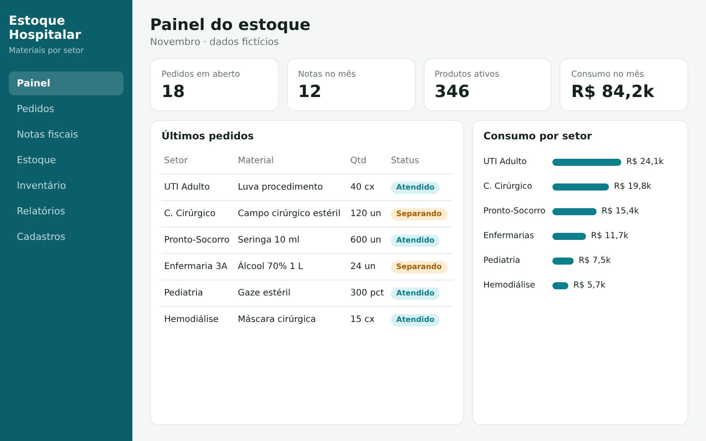
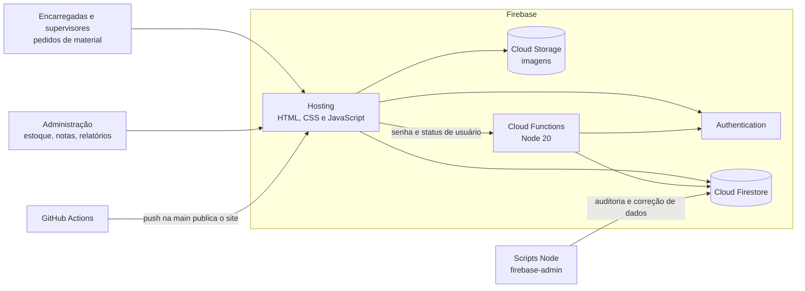

# Estoque Hospitalar · materiais por setor

Sistema web de controle de estoque hospitalar e de pedidos de material por setor: as equipes pedem material, e a administração cuida das notas fiscais de entrada, do estoque, do inventário e dos relatórios de consumo por setor.

> O código é privado (projeto de cliente). Este repositório documenta o projeto.

  

## Problema

A operação hospitalar distribui material de consumo e equipamentos para equipes espalhadas em vários setores e turnos. Era preciso saber o que entrou por nota fiscal, o que saiu para cada setor, quem pediu e quanto isso custou no mês, sem depender de planilhas soltas e conferência manual.

## Solução

Um sistema web servido pelo Firebase, sem servidor próprio para manter. Encarregadas e supervisores fazem os pedidos (livres ou a partir de uma lista padrão por setor e turno); a área administrativa registra as notas fiscais, que alimentam o estoque, atende os pedidos e acompanha o consumo em relatórios com gráficos e exportação.

## Funcionalidades principais

- **Pedidos de material:** pedido livre e pedido padrão por setor e turno; supervisor pode pedir em nome de uma encarregada.
- **Pedidos e histórico:** atendimento, edição e exclusão de itens com ajuste do estoque; histórico por funcionário.
- **Notas fiscais de entrada:** produtos da nota, fornecedores, finalização que soma ao estoque e estorno com registro.
- **Estoque e inventário:** produtos com imagem e saldo, exportação do estoque em PDF, inventário com filtros e impressão.
- **Controle de equipamentos:** entrega e devolução de mops, com custo tratado à parte do material de consumo.
- **Relatórios de consumo:** por setor e por encarregada, com gráficos e exportação para Excel.
- **Cadastros:** funcionários, setores, grupos e permissões; importação de produtos, funcionários e setores por planilha; transferência de dados entre setores.
- **Acesso por papel:** supervisor, supervisor operacional, estoquista, encarregado e funcionário, com acesso por página.

## Arquitetura

O front-end é estático e conversa direto com o Firestore pelo SDK do Firebase. As operações que precisam de privilégio de administrador (trocar senha, ativar ou desativar um usuário) ficam em Cloud Functions.

## Decisões técnicas e desafios

1. **Serverless no Firebase.** Hosting, Authentication, Firestore, Storage e Functions cobrem o que o sistema precisa sem servidor para manter. O site é publicado sozinho a cada push na `main` (GitHub Actions), e os emuladores do Firebase permitem rodar tudo localmente.
2. **Estoque movimentado em transação.** Finalizar ou estornar uma nota fiscal, atender um pedido padrão e editar itens de um pedido rodam em transações do Firestore com incremento atômico do saldo. A edição de pedido foi reescrita em três fases (ler tudo, validar, gravar), porque intercalar leitura e escrita com dois ou mais produtos fazia a transação falhar; a finalização de nota também barra o clique duplo. *Por quê:* duas pessoas mexendo no mesmo produto ao mesmo tempo não podem deixar o saldo errado.
3. **Valor da saída gravado no pedido.** Cada item pedido guarda o valor unitário de distribuição vigente naquele momento, vindo da nota de entrada. *Por quê:* o relatório de consumo de um mês não pode mudar quando o preço do produto muda depois.
4. **Exclusão lógica.** Produto excluído é marcado como excluído, com data, e some das listas, mas continua existindo para os pedidos e relatórios antigos. *Por quê:* apagar de verdade quebraria o histórico.
5. **Equipamento não é consumível.** Um mop entra uma vez por nota e é entregue e devolvido muitas vezes; somar o preço a cada entrega inflava o custo do mês. O relatório passou a contar equipamento pelo valor da nota de entrada, e consumível por quantidade vezes valor unitário. *Por quê:* o custo por setor precisa refletir o que foi comprado, não quantas vezes o item circulou.
6. **Correção de dados com rede de segurança.** Quando os relatórios de consumo começaram a sair com valores zerados (itens pedidos sem valor de distribuição), o diagnóstico foi feito com auditoria direto no banco, e a correção com scripts Node (firebase-admin) que rodam primeiro em simulação com log, fazem backup antes de gravar, comparam backup e banco depois e têm script de reversão. *Por quê:* corrigir dado de produção sem poder voltar atrás era arriscado demais.

## Stack

| Camada | Tecnologias |
|---|---|
| Front-end | HTML, CSS e JavaScript, Bootstrap 5, Font Awesome |
| Relatórios | Chart.js, jsPDF + AutoTable, SheetJS (xlsx) |
| Backend | Firebase: Hosting, Authentication, Cloud Firestore, Cloud Storage, Cloud Functions (Node 20) |
| Scripts de dados | Node.js, firebase-admin |
| Entrega | GitHub Actions (deploy do Hosting), Firebase CLI e emuladores |

## Imagens

Tela de apresentação com dados fictícios. As telas reais têm dados de funcionários e não são mostradas.

## Meu papel

Projeto, desenvolvimento e implantação.
